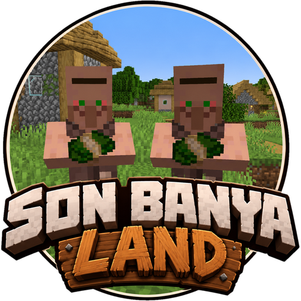

# ☘ Son Banyaland ☘

**Un servidor de Minecraft hecho entre amigos de Mallorca.** Una aldea que crece entre todos, mazmorras de verdad
difíciles, magia, una taberna, elecciones con parlamento, guerras entre aldeas y regatas de barcos sobre hielo.

Esta wiki cuenta **todo con los números exactos**: precios, encargos, efectos, radios... Las tablas salen directamente
de los mismos datos que usa el servidor, así que si algo del juego no cuadra con lo que pone aquí, **probablemente
sea un fallo**: avisa al admin.

!!! tip "Usa el buscador"
    Arriba tienes un buscador: escribe *katana*, *sello*, *zona segura*... y te lleva a la tabla donde sale.

## Lo primero que tienes que saber

- **La moneda fuerte son las chips** (I, II, III...), y salen sobre todo de las mazmorras. Las tiendas de los aldeanos
  cobran en **diamantes**. Todo en [Dinero](dinero.md).
- **La aldea es de todos.** Sube de nivel cuando los vecinos le entregan al Secretario lo que pide, y cada nivel trae
  aldeanos y tiendas nuevas. Todo en [Cómo crece la aldea](aldea.md).
- **El Pregonero** reparte misiones cada día. Dan **Sellos de la Aldea**, que se cambian por chips o se entregan para
  subir la aldea.
- **Alrededor de cada aldea hay una zona segura** que crece con el nivel. Ver [la tabla de radios](aldea.md#zona-segura).

### Las edades de la armadura

La armadura avanza por **edades**, y el admin las va abriendo más o menos cada semana:

| Edad | Qué armadura puedes llevar puesta |
|---|---|
| **Cobre** (la primera) | Cobre, cuero u oro |
| **Hierro** | Lo anterior + hierro y malla |
| **Diamante** | Lo anterior + diamante |
| **Netherita** | Todo |

Una armadura de una edad que aún no ha llegado **se puede guardar en el inventario, pero no ponérsela**: si te la
pones, cae a tus pies, y solo la puede recoger su dueño.

!!! warning "⚠️ PENDIENTE"
    Qué día se abre cada edad: lo decide el admin.

### Mazmorras y minijuegos

En las mazmorras y en los minijuegos se juega en **modo aventura** (no se pueden romper ni poner bloques), y **al
morir no pierdes el inventario** (en el mundo normal, sí). Todo sobre las mazmorras en [Mazmorras](mazmorras.md); los
barcos tendrán su página más adelante.

### Normas del servidor

!!! warning "⚠️ PENDIENTE"
    Las normas básicas de convivencia: las tiene que escribir el admin.

---

*¿Ves algo mal o que falta? Avisa al admin. En cada página hay un lápiz arriba a la derecha para proponer cambios.*
