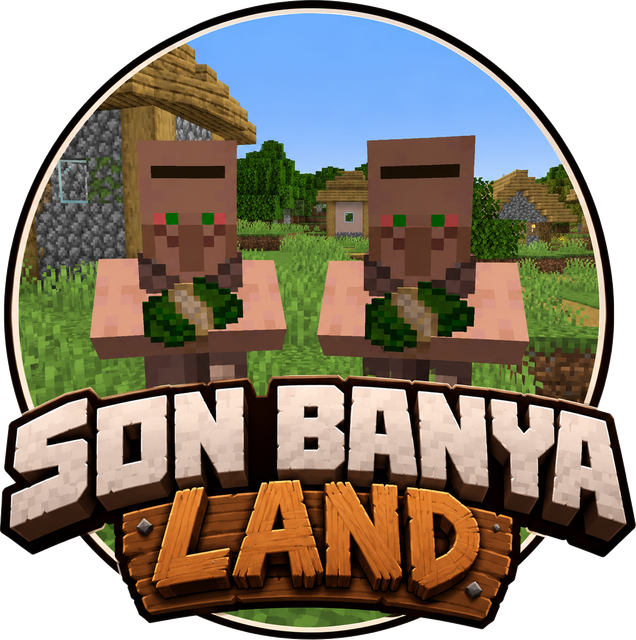
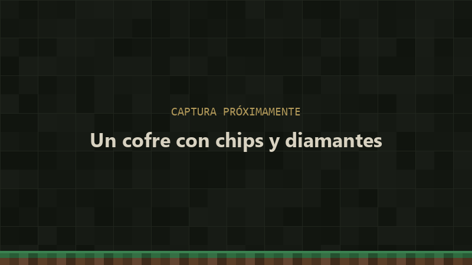
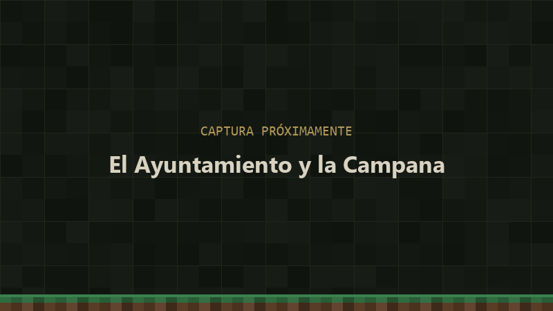
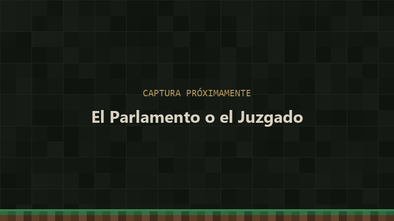
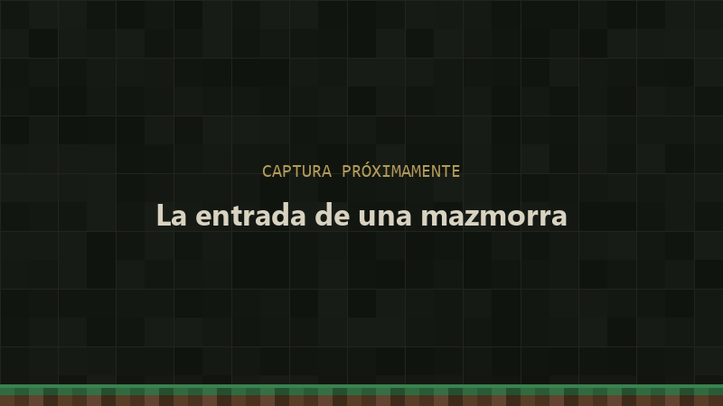
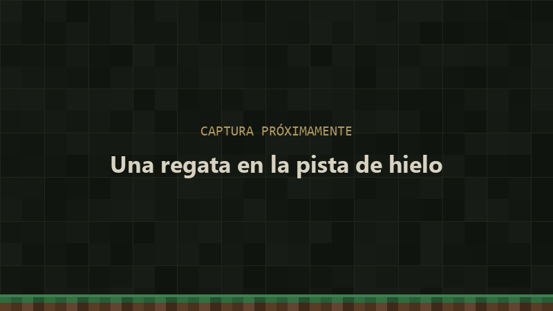
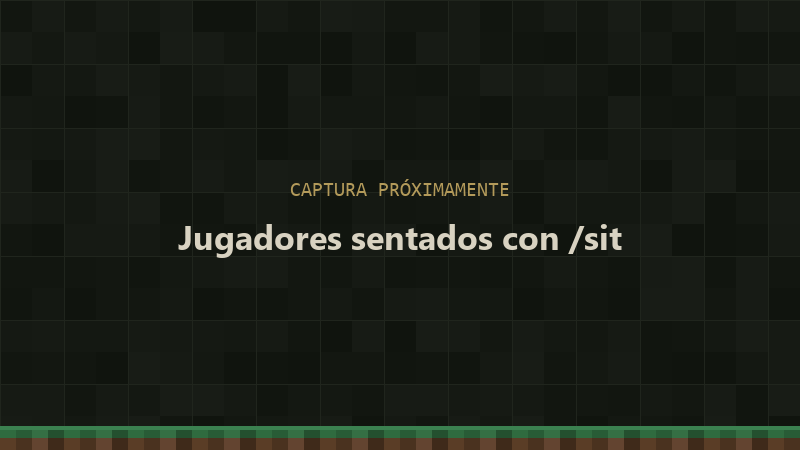

☘ Servidor de Minecraft ☘

# Son Banyaland

**Un servidor de rol: de mí para ti, de mí para vosotros.** Una aldea que crece entre todos, mazmorras de verdad
difíciles, magia, una taberna, elecciones con parlamento, guerras entre aldeas y regatas de barcos sobre hielo.

<label class="sb-buscador" for="__search">:material-magnify: Busca en la wiki… <kbd>/</kbd></label>

Escribe <em>katana</em>, <em>sello</em>, <em>zona segura</em>… y te lleva a la tabla donde sale.

[Empieza aquí](dinero.md){ .md-button .md-button--primary }
[Explora la wiki](#explora-la-wiki){ .md-button }

:material-database-check-outline:

Esta wiki cuenta **todo con los números exactos**: precios, encargos, efectos, radios... Las tablas salen directamente
de los mismos datos que usa el servidor, así que si algo del juego no cuadra con lo que pone aquí, **probablemente
sea un fallo**: avisa al admin.

Para empezar

## Lo primero que tienes que saber

-   :material-poker-chip:

    **La moneda fuerte son las chips** (I, II, III...), y salen sobre todo de las mazmorras. Las tiendas de los
    aldeanos cobran en **diamantes**. Todo en [Dinero](dinero.md).

-   :material-home-group:

    **La aldea es de todos.** Sube de nivel cuando los vecinos le entregan al Secretario lo que pide, y cada nivel
    trae aldeanos y tiendas nuevas. Todo en [Cómo crece la aldea](aldea.md).

-   :material-bullhorn-outline:

    **El Pregonero** reparte misiones cada día. Dan **Sellos de la Aldea**, que se cambian por chips o se entregan
    para subir la aldea. Ver [Misiones](misiones.md).

-   :material-shield-home-outline:

    **Alrededor de cada aldea hay una zona segura** que crece con el nivel. Ver
    [la tabla de radios](aldea.md#zona-segura).

El mundo

## Explora la wiki

-   [{ .sb-captura loading=lazy alt="" }](dinero.md)

    
Empezar

    ### :material-sack: [Dinero](dinero.md)

    Chips, diamantes y Sellos de la Aldea: qué vale cada cosa y de dónde sale.

    [Chips](dinero.md#chips){ .sb-chip } [Diamantes](dinero.md#diamantes){ .sb-chip } [Sellos](dinero.md#sellos-de-la-aldea){ .sb-chip }

    [Entrar →](dinero.md){ .sb-entrar }

-   [{ .sb-captura loading=lazy alt="" }](aldea.md)

    
La aldea

    ### :material-home-group: [La aldea](aldea.md)

    Cómo sube de nivel, sus aldeanos y tiendas, la Taberna, las misiones y tu casa.

    [Niveles](aldea.md#los-niveles){ .sb-chip } [Aldeanos](aldeanos.md){ .sb-chip } [Taberna](taberna.md){ .sb-chip } [Misiones](misiones.md){ .sb-chip } [Casas](casas.md){ .sb-chip }

    [Entrar →](aldea.md){ .sb-entrar }

-   [{ .sb-captura loading=lazy alt="" }](politica.md)

    
La aldea

    ### :material-bank-outline: [Gobierno y guerra](politica.md)

    Elecciones y leyes, los proyectos de la Oficina, impuestos, juicios, la Iglesia y la guerra entre aldeas.

    [Política](politica.md){ .sb-chip } [Proyectos](proyectos.md){ .sb-chip } [Hacienda](hacienda.md){ .sb-chip } [Justicia](justicia.md){ .sb-chip } [Iglesia](iglesia.md){ .sb-chip } [Guerra](guerra.md){ .sb-chip }

    [Entrar →](politica.md){ .sb-entrar }

-   [{ .sb-captura loading=lazy alt="" }](mazmorras.md)

    
Mazmorras y objetos

    ### :material-sword-cross: [Mazmorras](mazmorras.md)

    Tres mazmorras con sus monstruos, jefes y tesoros, y lo que se hace con su botín: armas, armaduras y magia.

    [Mazmorras](mazmorras.md){ .sb-chip } [Armas y armaduras](forja.md){ .sb-chip } [Magia](magia.md){ .sb-chip }

    [Entrar →](mazmorras.md){ .sb-entrar }

-   [{ .sb-captura loading=lazy alt="" }](minijuegos.md)

    
Minijuegos

    ### :material-sail-boat: [Minijuegos](minijuegos.md)

    Regatas de barcos sobre hielo, con neumáticos y boxes, y las cabezas coleccionables del lobby.

    [Regatas](minijuegos.md#las-regatas){ .sb-chip } [Neumáticos](minijuegos.md#neumaticos-modo-gestion){ .sb-chip } [Cabezas](minijuegos.md#cabezas-coleccionables){ .sb-chip }

    [Entrar →](minijuegos.md){ .sb-entrar }

-   [{ .sb-captura loading=lazy alt="" }](plugins.md)

    
Plugins

    ### :material-console-line: [Comandos y extras](plugins.md)

    Registrarte, sentarte, colgar imágenes, poner música y los comandos útiles.

    [Registro](plugins.md#registrarte-y-entrar){ .sb-chip } [Sentarse](plugins.md#sentarse-y-tumbarse){ .sb-chip } [Imágenes](plugins.md#imagenes-en-marcos){ .sb-chip }

    [Entrar →](plugins.md){ .sb-entrar }

Accesos rápidos

## Las tablas más consultadas

- [Niveles de la aldea *Qué pide el Secretario*](aldea.md#los-niveles)
- [Zona segura *Radio en cada nivel*](aldea.md#zona-segura)
- [Bebidas *Efectos de cada una*](taberna.md#las-bebidas-y-sus-efectos)
- [Cofres del vestíbulo *Qué puede salir*](mazmorras.md#los-cofres-del-vestibulo)
- [Armas con plano *Épicas y legendarias*](forja.md#armas-con-plano)
- [Misiones *Todas las que pueden salir*](misiones.md#todas-las-misiones-que-pueden-salir)
- [Los dioses *Devoción y bendiciones*](iglesia.md#los-dioses)
- [Neumáticos *Para el modo Gestión*](minijuegos.md#neumaticos-modo-gestion)

La crónica

## Lo que va pasando en el mundo

Aldeas fundadas, alcaldes elegidos, guerras, asedios, récords... Todo queda apuntado en la
[Historia de Son Banyaland](historia.md).

[Leer la Historia](historia.md){ .md-button }

Progresión

## Las edades de la armadura

Es **la norma principal del servidor**: la armadura avanza por **edades**, y **cada semana se abre la siguiente**.

| Semana | Edad | Qué armadura puedes llevar puesta |
|---|---|---|
| 1.ª | **Cobre** | Cobre, cuero y oro |
| 2.ª | **Hierro** | Lo anterior + hierro y malla |
| 3.ª | **Diamante** | Lo anterior + diamante |
| 4.ª | **Netherita** | Todo |

El caparazón de tortuga se puede llevar siempre. Cuando cambia la edad, sale un aviso a todos.

Una armadura de una edad que aún no ha llegado **se puede guardar en el inventario, pero no ponérsela**: si te la
pones, cae a tus pies, y solo la puede recoger su dueño.

Antes de jugar

## Mazmorras y minijuegos

En las mazmorras y en los minijuegos se juega en **modo aventura** (no se pueden romper ni poner bloques), y **al
morir no pierdes el inventario** (en el mundo normal, sí). Todo sobre las mazmorras en [Mazmorras](mazmorras.md); las
regatas de barcos en [Minijuegos](minijuegos.md).

## Normas del servidor

- **Respeta las edades de la armadura** (arriba): cada semana, la suya.

!!! tip "Usa el buscador"
    Arriba tienes un buscador: escribe *katana*, *sello*, *zona segura*... y te lleva a la tabla donde sale.

---

*¿Ves algo mal o que falta? Avisa al admin. En cada página hay un lápiz arriba a la derecha para proponer cambios.*

